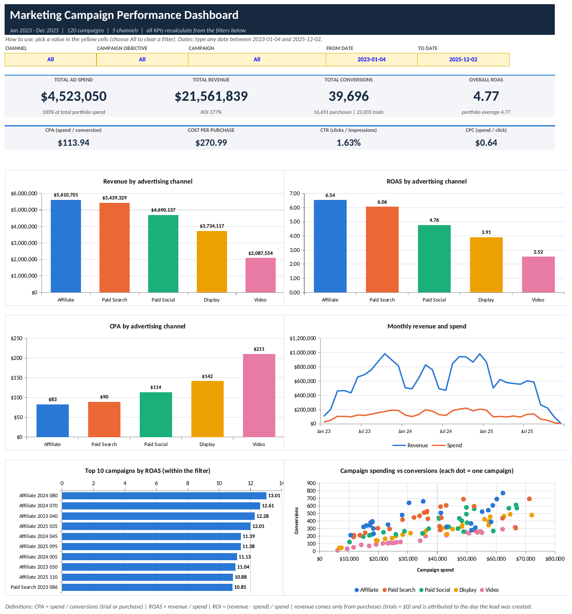
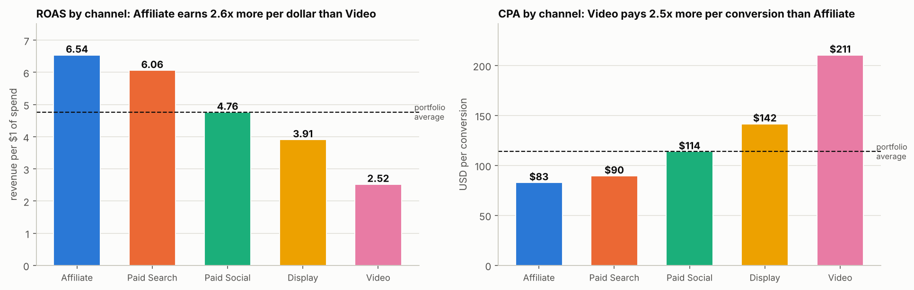
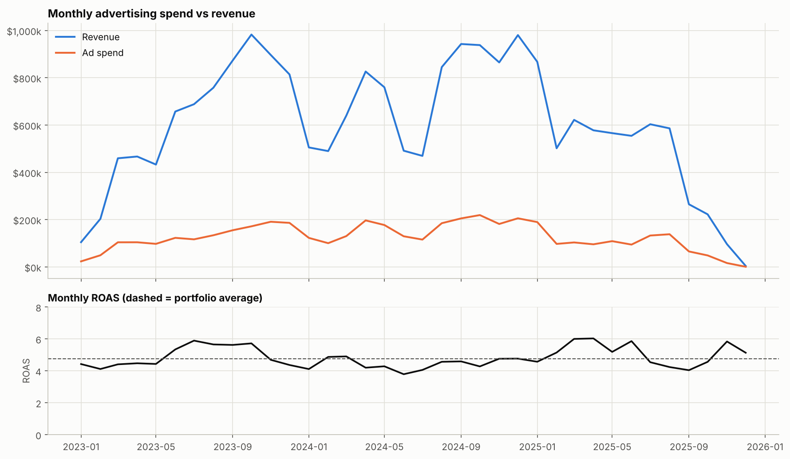
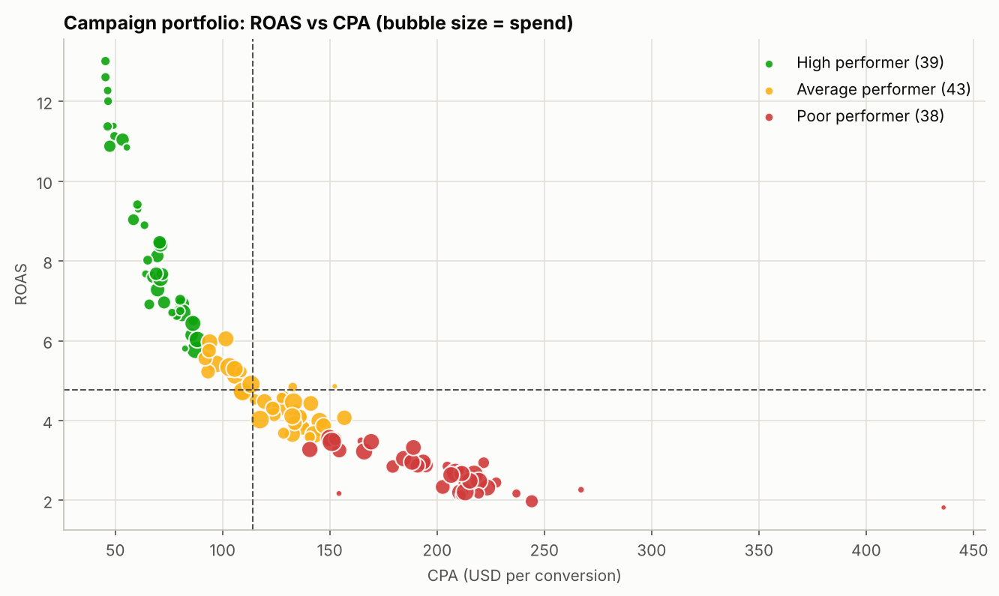

# Marketing Campaign Performance Analysis

> **Which advertising channels, campaigns and objectives deserve more budget — and which should be optimised or stopped?**
> An end-to-end analytics project using **SQL, Python and Excel** on 120 digital advertising campaigns (2023–2025).

## Project objective

Turn raw campaign data (spend, clicks, leads, conversions, revenue) into a **budget decision**: measure efficiency with marketing KPIs, classify campaigns into high / average / poor performers, and propose how to split a marketing budget — as a hypothesis to test, not a guaranteed improvement.

## Dataset

**Marketing Campaigns & Conversions v1.0.0** — SQLite database (+ pre-joined daily Excel file) provided with the project guideline. Original files are kept untouched in `data/raw/`.
*Dataset page / license: add the download link here.*

| Table | Rows | Grain |
|---|---|---|
| `campaigns` | 120 | 1 row per campaign (5 channels × 24, 3 objectives) |
| `daily_spend` | 11,240 | 1 row per campaign per day (impressions, clicks, spend) |
| `leads` | 261,684 | 1 row per lead |
| `conversions` | 39,696 | 1 row per conversion (*trial* = $0 revenue, *purchase* = revenue > 0) |

Period: 2023-01-04 → 2025-12-02. Revenue and conversions are attributed to the day the lead was created.

## Tools used

| Tool | Used for |
|---|---|
| **SQL (SQLite)** | Exploration, data-quality checks, cleaning views, KPIs, 22 business queries (CTEs, window functions) |
| **Python** (Pandas, NumPy, Matplotlib, Seaborn, SciPy) | Validation, EDA, visualisations, campaign tiers, budget scenarios |
| **Excel** | Interactive dashboard (KPI cards, 6 charts, dropdown filters), formula-driven analysis sheets |

## Business questions

1. Which advertising channel generates the highest revenue?
2. Which campaigns generate the most conversions?
3. Which campaigns have the lowest acquisition costs?
4. Which channels generate the highest ROAS?
5. Are some campaigns spending too much without generating enough conversions?
6. Which campaign objectives perform best?
7. Does campaign performance change over time?
8. Which channels deserve more marketing budget?
9. Which campaigns should be optimised or stopped?

## KPIs analysed

| KPI | Formula |
|---|---|
| CTR | Clicks / Impressions × 100 |
| CPC | Spend / Clicks |
| Conversion rate | Conversions / Clicks × 100 |
| CPA | Spend / Conversions |
| ROAS | Revenue / Spend |
| ROI | (Revenue − Spend) / Spend × 100 |
| Cost per purchase *(added)* | Spend / Purchases |

## Main findings

| | |
|---|---|
| Total ad spend | **$4,523,050** |
| Attributed revenue | **$21,561,839** |
| Conversions | **39,696** (16,691 purchases, 23,005 free trials) |
| Overall ROAS / CPA | **4.77** / **$113.94** |

| Channel | Spend | Revenue | ROAS | CPA |
|---|---:|---:|---:|---:|
| Affiliate | $857,835 | $5,610,701 | **6.54** | $82.87 |
| Paid Search | $897,092 | $5,439,329 | **6.06** | $89.54 |
| Paid Social | $984,732 | $4,690,137 | 4.76 | $113.87 |
| Display | $955,297 | $3,734,117 | 3.91 | $141.65 |
| Video | $828,095 | $2,087,554 | 2.52 | $210.55 |

- **Affiliate and Paid Search** generate 51% of revenue with 39% of spend; **Video** takes 18% of spend for 10% of revenue.
- **All 24 Video campaigns are poor performers**; 38 poor performers (of 120) absorb 34% of the budget at ROAS 2.81 vs 7.98 for the 39 high performers.
- **25 campaigns** spend above average but convert below average (28% of spend, ROAS 3.03).
- **The best objective depends on the channel** — Paid Social: Lead Generation 6.17 vs Acquisition 3.67; Affiliate: Acquisition 7.58 vs Lead Generation 4.92.
- **Performance is stable over time** (monthly ROAS 3.8–6.0, yearly 5.03 / 4.44 / 5.00): channel gaps are structural.
- **Scaling risk:** larger Affiliate / Paid Search / Paid Social campaigns earn a lower ROAS (r = −0.82 / −0.75 / −0.55) → diminishing returns.

## Budget recommendation (hypothetical $100,000)

| Channel | Current mix | Proposed |
|---|---:|---:|
| Affiliate | $18,966 | **$30,000** |
| Paid Search | $19,834 | **$27,000** |
| Paid Social | $21,771 | **$22,000** |
| Display | $21,121 | **$15,000** |
| Video | $18,308 | **$6,000** |

If the extra dollars keep earning each channel's historical ROAS, revenue would be ~13% higher; if they earn only half of it, the gain is ~0.7%. The dataset does not measure incremental conversions, so this is a **data-driven recommendation to validate with a controlled split test**. Full reasoning (capacity, conversion volume, CPA targets, objectives, consistency) is in the report.

## Screenshots

**Excel dashboard**



**ROAS and CPA by channel**



**Monthly spend vs revenue**



**Campaign tiers**



## Repository structure

```
Marketing-Campaign-Performance-Analysis/
├── data/
│   ├── raw/        original SQLite database and Excel file (never modified)
│   └── cleaned/    analytical dataset, cleaned daily data, summary tables, SQL KPI exports
├── sql/
│   ├── 01_database_exploration.sql   structure + data-quality checks
│   ├── 02_data_cleaning.sql          cleaning views, campaign-day aggregation, reconciliation
│   ├── 03_marketing_kpis.sql         CTR, CPC, conversion rate, CPA, ROAS, ROI views
│   ├── 04_business_analysis.sql      22 business queries
│   └── run_sql_scripts.py            runs the scripts on a temporary copy and exports the KPI tables
├── python/
│   └── marketing_campaign_analysis.ipynb   cleaning, KPIs, EDA, visualisations, findings
├── excel/
│   └── marketing_dashboard.xlsx      Raw_Data, Cleaned_Data, Campaign_Analysis, Channel_Analysis, Monthly_Trends, Dashboard
├── reports/
│   ├── final_project_report.pdf      final report (10 sections)
│   └── figures/                      charts used in the notebook, report and README
└── README.md
```

## How to reproduce

```bash
pip install -r requirements.txt
python sql/run_sql_scripts.py                    # runs the 4 SQL scripts on a temporary copy of the raw DB, exports data/cleaned/sql_*.csv
jupyter notebook python/marketing_campaign_analysis.ipynb   # run all cells (cwd = python/)
```

The SQL scripts can also be opened one by one in any SQLite client (DB Browser for SQLite, DBeaver…) — open a **copy** of the raw database so the original stays untouched.

### Using the Excel dashboard
Open `excel/marketing_dashboard.xlsx` (it opens on **Dashboard**). Use the yellow cells to filter by **Channel**, **Campaign objective**, **Campaign** and **date range**; KPI cards and charts recalculate. Analysis tables are formula-driven (SUMIFS over the `tblCleaned` table); because the cleaned data is an Excel Table, a native PivotTable or slicer can be added with *Insert → PivotTable / Slicer*.

## Limitations

Revenue is *attributed* revenue (no profit margin, no customer lifetime value, no control group); 58% of conversions are trials with $0 revenue; correlations are observational. Treat the budget split as an experiment to run, not a forecast.
